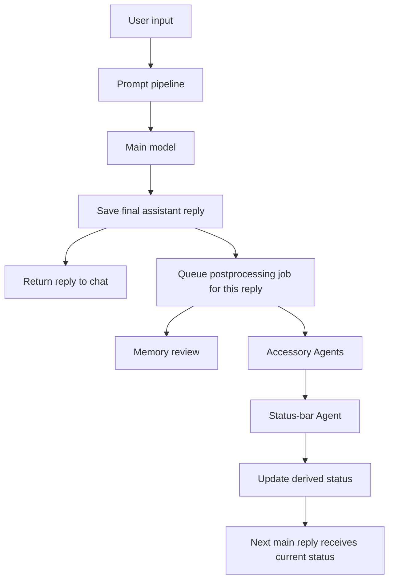

# Chat Reply And Agent Context

## Turn Flow

The main reply is the user-facing story. The backend saves it and returns it
without waiting for accessory Agents. A background job is linked to the saved
assistant message and processes that turn. The status-bar Agent cannot rewrite
the main reply; its writes update conversation state for later turns.

Send, continue, and regenerate use the same postprocessing relationship.
Regenerate replaces the active assistant candidate and queues processing for
the replacement. Revision checks prevent a stale job from applying after the
conversation history changes.

## Context By Model Call

| Call | Context it receives | How it affects the conversation |
| --- | --- | --- |
| Main chat model | Character instructions, active preset, retained world-book entries, current status-variable summary, scene/economy/talent context, retained memories and mods, selected conversation history, and the current user input. The prompt budget may omit optional history or context sections. | Produces the visible assistant text. Its status-bar context is a read-only snapshot; status-bar tools are not part of this call. |
| Status-bar Agent | The current pre-update status and variables, status-bar template/runtime and structural hints, status-bar tracking/edit rules, plus the current user input and saved final assistant text. It can use its configured provider/model/thinking level and enabled editing tools. | May update status variables or template code. A no-change decision leaves the main reply and status untouched. |
| Memory Agent | The current user/assistant turn, memory records and history returned by its search tools, with evidence tied to message IDs and revisions. | Reviews durable continuity facts separately from the visible reply. |
| Other accessory Agents | The current user/assistant turn plus domain-specific current state, such as economy, scene, quests, or world clock. | Apply structured state changes after the reply; they do not produce a second user-facing answer. |

The exact main-model request is the final budgeted `messages` array, not every
candidate shown in a context preview. The prompt pipeline separates sources so
optional sections can be removed without splitting a user/assistant turn.

## Status-Bar Evidence

The status-bar Agent treats the current assistant reply as the primary evidence
for a story-state change. A user request, plan, attempted action, hypothetical,
or old-history reference does not by itself prove that a change occurred.
Status-bar rules describe what to track; they are not evidence of a value.

The Agent sees the most recently saved status as its starting point and can
make precise variable or template edits. The next main-model call reads the
updated variables if that status section survives context budgeting. The main
reply already shown to the user is never regenerated as a side effect of a
status update.

The chat status indicator follows the postprocessing job ID attached to the
saved assistant message. It stays active while that job is queued or running,
then refreshes status and economy panels when the job reaches a terminal state.
This ties “updated”, “no change”, and “processing failed” to the reply that
triggered the job instead of inferring completion from elapsed time.
