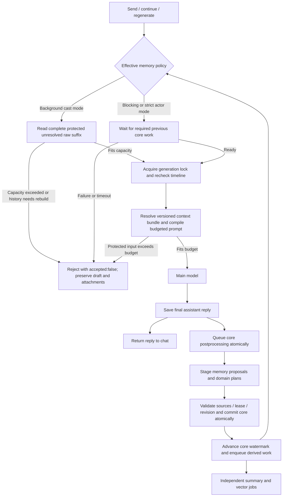

# Chat Reply And Agent Context

## Turn Flow

The main reply is the user-facing story. The backend saves it and returns it
without waiting for that reply's core processing. The default `background`
policy lets the next cast-mode generation proceed while ordered core work is
pending or has a recoverable failure. It includes the complete raw suffix from
the earliest unresolved turn through the selected history cutoff, including
the turn's user message, later user/assistant messages, revisions and attachments.
Every message in this suffix is protected during prompt budgeting; completing
canonical acceptance removes the covered prefix. It is not a rolling tail that
silently discards older unresolved turns.

If this suffix exceeds `shortTermTurns`, generation returns `accepted:false`
with an explicit capacity error. If protected input cannot fit the configured
dialogue budget or model window, generation rejects before a provider call
instead of trimming that input. Draft and attachments remain available for
retry. Rebuild-required history still needs explicit recovery. Explicit
`blocking` mode and strict actor mode wait for required previous core work
outside the generation lock and before saving the user message; failure or
timeout also returns `accepted:false`. Later core jobs cannot skip an earlier
watermark gap. Summary and vector jobs have separate scheduling and never hold
up a core-ready next turn.

Send, continue, and regenerate use the same postprocessing relationship.
Regenerate replaces the active assistant candidate and queues processing for
the replacement. Revision checks prevent a stale job from applying after the
conversation history changes. Jobs retain explicit owner, conversation,
timeline and stage scope independently of their serial scheduling key.

## Context By Model Call

| Call | Context it receives | How it affects the conversation |
| --- | --- | --- |
| Main chat model | The versioned context bundle, selected history and current user input. Cast mode may include character/preset/lore, current domain state, memories and mods subject to budgeting. Strict actor mode applies the restrictions below. | Produces the visible assistant text. Domain context is read-only; status-bar tools are not part of this call. |
| Status-bar Agent | The pre-update status, template/runtime and edit rules, current user input and saved assistant text, using its configured provider/model/thinking/tools. With `statusLink`, it also receives validated memory extraction and the same source evidence. | Plans edits against an isolated database copy; accepted edits join the guarded core transaction. A no-change result leaves status untouched. |
| Memory Agent | The current turn, existing memory/search results, entity references and evidence tied to message IDs, revisions and retained source versions. With `statusLink`, the pre-update authoritative status supplies tracking context, not evidence of a change. | Stages proposals; `finish_memory_review` seals the optional structured packet. Only the validated canonical commit makes records durable. Failure leaves no half-applied durable facts and does not fall back to rule extraction. |
| Other accessory Agents | The current turn, accepted extraction proposal where applicable and domain-specific state in the planning copy. | Plan domain changes for the same atomic core acceptance; they do not produce a second user-facing answer. |
| Summary worker | Accepted source records with dependency hashes, grouped into scene/chapter/arc summaries. | Updates only the derived summary hierarchy and its watermark. Source races invalidate its own work. |
| Embedding worker | Eligible narrative documents and a separately selected owned embedding profile. | Builds/resumes a shadow index and atomically switches the completed generation. Query similarity cannot establish facts or grant actor knowledge. |

The exact main-model request is the final budgeted `messages` array. Generation,
preview and evaluation share the resolved bundle and selection rules; saved
traces retain the actual request. A dry-run preview neither advances lore
trigger state nor initiates a paid query embedding. Optional sections are
removed without splitting a user/assistant turn.

Strict actor mode requires a valid conversation actor and uses that actor's
eligible propositions and beliefs. It excludes unclassified raw history,
author summaries, character prose, presets, mods and domain-state sections;
lore requires public or matching cast-key audience. Unsafe provider-inherited
context fails closed. Current explicit user input still belongs to the caller;
a single cast-mode call portraying multiple characters does not isolate what
the model knows for each character.

## Shared Memory Policy

The same normalized `memoryPolicy` is used by conversation settings, author
defaults, inheritance, import/export and AI settings edits. The workflow fields
are:

| Field | Default | Meaning |
| --- | --- | --- |
| `syncMode` | `background` | Protected raw continuity in cast mode; `blocking` explicitly waits for core work. Strict actor mode still waits regardless of this field. |
| `shortTermTurns` | `8`, bounded `1–32` | Maximum complete unresolved turns in the protected suffix. Exceeding it rejects generation rather than dropping story text. |
| `autoConsolidate` | `true` | Allows automatic consolidation through existing staged merge/update tools, preserving sources, history, pinned records and incompatible actor/audience/truth scopes. Disabling it removes automatic merge capability. |
| `statusLink` | `false` | Shares tracking context and validated extraction between the two enabled Agents; each retains its own tools/provider and the common guarded core commit. It does not enable the status-bar Agent. |

The settings dialog uses automatic consolidation as the sole product merge
switch and saves the corresponding `merge_memories` capability with it.

## Character Memory Workspace

The memory view is titled **记忆工作台**. Its default character dossier lists
canonical story actors and the enrolled main character, including named actors
without a separate character card. Search matches names and aliases; dossiers
separate memories, events, relationships and possessions. Possession records
retain supporting ownership evidence and link authoritative scene records when
available; an unspecified quantity stays unspecified.

Selecting a dossier is an author's filter over related records, not a change
to the character's actual knowledge. Strict viewer scope remains a separate
permission filter. Owner, branch, historical cutoff and revision rules still
apply. Dossiers are read-only in this UI; **全部记忆** retains the existing
review, correction and editing actions.

Historical reads pin a checkpoint and its canonical commit ancestry. Full
snapshot v3 retains canonical records and evidence; per-turn checkpoints keep
memory watermarks and references, with vector indexes rebuilt after restore.
Legacy v2 reads remain supported without fabricating missing knowledge history.

## Status-Bar Evidence

The status-bar Agent treats the current assistant reply as the primary evidence
for a story-state change. A user request, plan, attempted action, hypothetical,
or old-history reference does not by itself prove that a change occurred.
Status-bar rules describe what to track; they are not evidence of a value.

The Agent plans precise variable or template edits from the current saved
status. The commit rechecks its source state before applying those edits. Once
required core work is ready, a later cast-mode call can read the updated
variables if that section survives budgeting. During background lag, the
protected raw suffix supplies newer story evidence while accepted domain state
may still lag; status cooperation does not create a second quantity or balance
ledger. A status update never regenerates the main reply already shown to the
user.

Normal queued/running core and derived progress is silent in chat. Polling
still tracks core readiness, required stages, stage jobs and core/summary/index
watermarks for the active conversation and submitted run. Core completion
refreshes domain panels without replacing the message list or draft. Failures
retain a concise **查看记忆** entry; detailed errors, retry, cancel and guarded
rebuild confirmation live under **同步与恢复** in the memory workspace. A derived
failure does not disable a core-ready send, and a recoverable core failure can
still use the bounded background continuity path described above.

The current embedding adapter is explicitly configured for Beijing DashScope
`qwen3.7-text-embedding-flash`, with native sqlite-vec storage. Clean Windows
Node 24 installation and mocked provider contracts were checked; actual Qwen
story retrieval quality, latency and live billing were not measured. See
[AI runtime](ai-runtime.md#向量记忆运行时) for the supported boundary.
